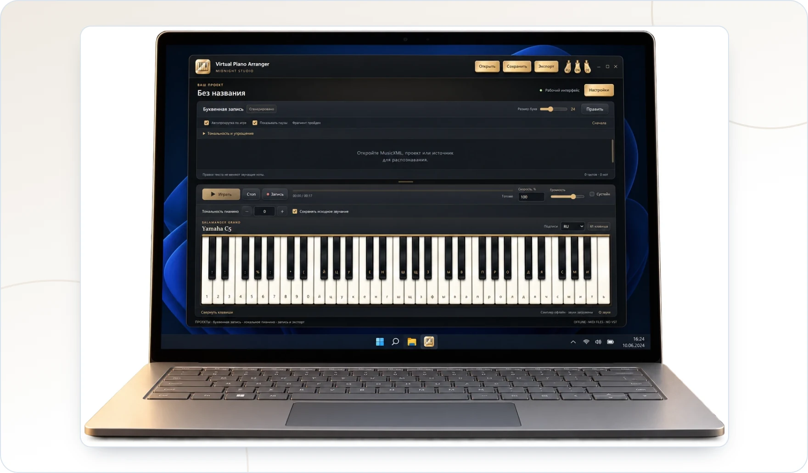

<!-- ppk-readme:head:start -->
<a href="https://popovantondev.github.io/VirtualPianoArranger/index-ru.html"><picture><source media="(prefers-color-scheme: dark)" srcset="https://raw.githubusercontent.com/popovantondev/VirtualPianoArranger/main/docs/readme/header-ru-dark.0c226fd2.svg"></picture></a>
<!-- ppk-readme:head:end -->

# Virtual Piano Arranger

**Русский** · [Deutsch](README.md) · [English](README.en.md)

<!-- ppk-readme:body:start -->

<a href="https://github.com/popovantondev/VirtualPianoArranger/releases/tag/v0.1.0-preview.1"><picture><source media="(prefers-color-scheme: dark)" srcset="https://raw.githubusercontent.com/popovantondev/VirtualPianoArranger/main/docs/readme/btn-download-ru-dark.fb98a1ec.svg"></picture></a>
<a href="https://popovantondev.github.io/VirtualPianoArranger/index-ru.html"><picture><source media="(prefers-color-scheme: dark)" srcset="https://raw.githubusercontent.com/popovantondev/VirtualPianoArranger/main/docs/readme/btn-website-ru-dark.075119e7.svg"></picture></a>
<a href="https://popovantondev.github.io/VirtualPianoArranger/Guide-ru.html"><picture><source media="(prefers-color-scheme: dark)" srcset="https://raw.githubusercontent.com/popovantondev/VirtualPianoArranger/main/docs/readme/btn-guide-ru-dark.1c51eb07.svg"></picture></a>
<a href="https://popovantondev.github.io/VirtualPianoArranger/play-ru.html"><picture><source media="(prefers-color-scheme: dark)" srcset="https://raw.githubusercontent.com/popovantondev/VirtualPianoArranger/main/docs/readme/btn-demo-ru-dark.14b9387b.svg"></picture></a>
<a href="https://github.com/popovantondev/VirtualPianoArranger/issues/new"><picture><source media="(prefers-color-scheme: dark)" srcset="https://raw.githubusercontent.com/popovantondev/VirtualPianoArranger/main/docs/readme/btn-bug-ru-dark.7b2428c0.svg"></picture></a>

<a href="https://raw.githubusercontent.com/popovantondev/VirtualPianoArranger/main/assets/surface-laptop-cutout-ru.webp"><picture><source media="(prefers-color-scheme: dark)" srcset="https://raw.githubusercontent.com/popovantondev/VirtualPianoArranger/main/docs/readme/preview-ru-dark.9a5a4792.webp"></picture></a> 
<a href="https://raw.githubusercontent.com/popovantondev/VirtualPianoArranger/main/assets/surface-laptop-cutout-ru.webp">Снимок целиком</a>

<picture><source media="(prefers-color-scheme: dark)" srcset="https://raw.githubusercontent.com/popovantondev/VirtualPianoArranger/main/docs/readme/divider-dark.4b41da9b.svg"></picture>
<!-- ppk-readme:body:end -->

Офлайн-пианино с буквенной записью, выбором партий MIDI и адаптацией нот для компьютерной клавиатуры из 61 клавиши.

**Windows x64 · Русский / Deutsch / English · 0.1.0-preview.1**

*Иллюстрация на ноутбуке; не проверка совместимости устройства.*

Учебный некоммерческий демонстрационный проект: изучение музыкального ПО и показ его возможностей. Автор не продаёт приложение. Это описание цели проекта, а не ограничение прав, предоставленных MIT и лицензиями сторонних компонентов. Проект не заявляет о связи с авторами этих компонентов или об их одобрении.

## Возможности

| MIDI · выбор партий | Буквенная запись |
|---|---|
| Озвучка и WAV | Предпросмотр тональности |

[Скачать portable для Windows](https://github.com/popovantondev/VirtualPianoArranger/releases/download/v0.1.0-preview.1/VirtualPianoArranger-0.1.0-preview.1-windows-x64-portable.zip) · [SHA-256](https://github.com/popovantondev/VirtualPianoArranger/releases/download/v0.1.0-preview.1/SHA256SUMS.txt) · [Соответствующие исходники](https://github.com/popovantondev/VirtualPianoArranger/releases/download/v0.1.0-preview.1/VirtualPianoArranger-0.1.0-preview.1-corresponding-sources.zip)

## Начало работы

Распакуйте всю папку portable и запустите `VirtualPianoArranger.exe`. EXE нельзя переносить отдельно от остальных файлов. Устанавливать Python или получать права администратора не требуется.

Откройте MIDI, прослушайте партии и выберите нужные. Также доступны MusicXML, проекты VPA и буквенный TXT. Распознавание PDF/изображений требует комплектного runtime и остаётся экспериментальным: сверяйте высоты и ритм с оригиналом.

**Тональность и упрощение** над буквами открывает предпросмотр. В режимах ПК, умеренного и музыкального упрощения полнота регулирует сопровождение из исходных нот. В режимах одной ноты сокращать аккорды уже нечего. Связь **Сохранять исходное звучание** сохраняет высоты источника; регистр букв может отличаться от звучания.

**Показывать паузы** есть над записью и в окне тональности. Знак ставится при настоящей тишине выбранных партий, не вместо пробелов и микрозазоров MIDI. TXT не содержит длительностей: паузы и автоматическое проигрывание не выдумываются.

[Русское руководство](https://popovantondev.github.io/VirtualPianoArranger/Guide-ru.html) · [English guide](https://popovantondev.github.io/VirtualPianoArranger/Guide-en.html) · [Deutsche Anleitung](https://popovantondev.github.io/VirtualPianoArranger/Guide-de.html)

## Ограничения

MIDI звучит пианино, а не исходными инструментами General MIDI. Для некоторых файлов требуется согласие на приблизительное проигрывание. Запись/WAV работают локально; другие форматы экспорта требуют отдельно доступного FFmpeg. Распознавание аудио/видео и импорт YouTube пока не доступны. Точность распознавания, другой ПК и длинные сеансы ещё требуют проверки. EXE без цифровой подписи.

## Права и лицензия

Собственный код приложения распространяется по [MIT](LICENSE). Сторонний код, сэмплы пианино и модели сохраняют свои лицензии: MIT их не заменяет.

Сохраняйте папку целиком, лицензии и уведомления. У выпуска есть отдельные исходники и SHA-256; прочитайте [уведомления](DISTRIBUTION_NOTICES.md), [происхождение моделей](MODEL_PROVENANCE.md) и [инструкцию замены библиотек](LIBRARY_REPLACEMENT.md). Preview не означает, что проверены все партитуры или все компьютеры Windows.
